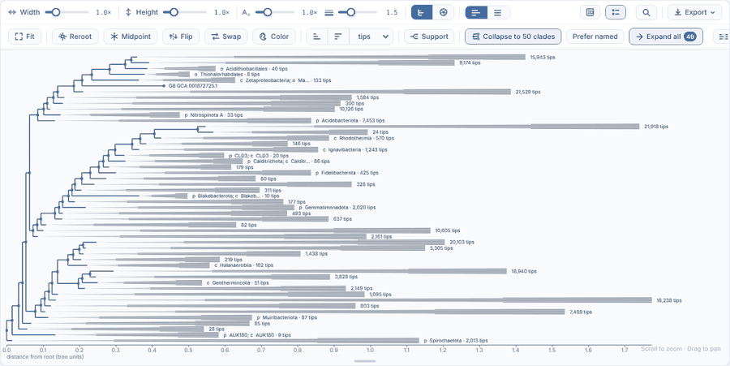
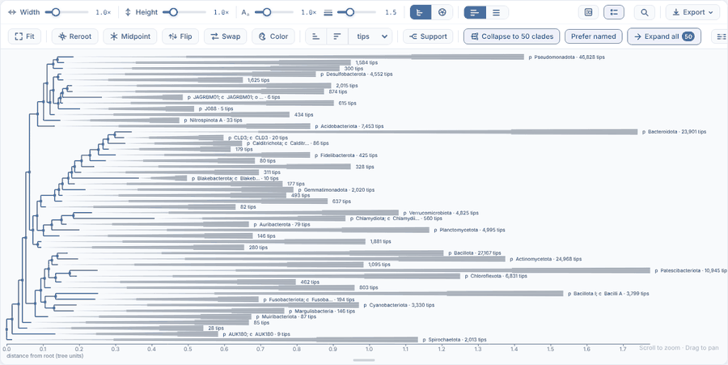
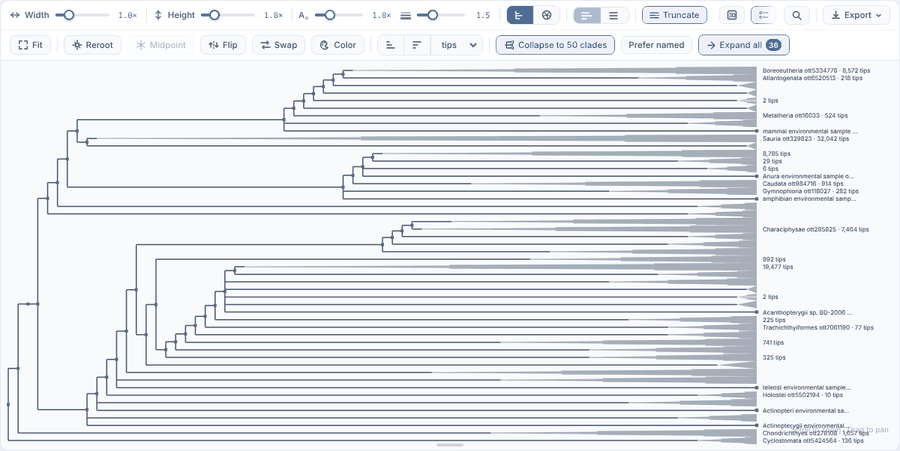
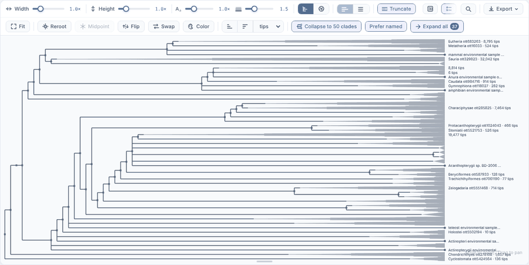

# Collapse to 50 clades: by size or preferring named clades (#57)

An experiment for [#57](https://github.com/MortenHofft/gbif-phylo/issues/57), to judge whether `by: 'named'` is worth keeping. Nothing here is
settled.

## What was compared

tree-ops `autoCollapse(t, { maxRows: 50 })` (through `mergeAutoCollapse`, as the explorer calls it) with:

- **`by: 'size'`** (the default): the collapsed clade with the most tips opens first.
- **`by: 'named'`**: every unnamed clade opens before any named one, whatever its size; among the named (and among the unnamed) the most tips
  first. The row budget holds the same way: a clade whose children don't fit stays collapsed.

A clade is named when the viewer's `cladeName` gives it a name: its label without the support value, through the explorer's `cladeLabel`,
which drops Open Tree's synthetic `mrcaott…` names. GTDB labels carry the support before the taxon (`98.0:p__Bacillota`), so a support-only
node is unnamed.

## Results (2026-10-23)

| Tree | Order | Rows | Collapsed clades | Named collapsed clades | Of which (GTDB rank) |
|---|---|---|---|---|---|
| GTDB 190k bacteria | size | 50 | 49 | 17 | 10 phyla, 5 classes, 2 orders |
| GTDB 190k bacteria | named | 50 | 50 | 27 | 27 phyla |
| OTL 100k vertebrata | size | 50 | 36 (plus 14 tips) | 26 | |
| OTL 100k vertebrata | named | 50 | 37 (plus 13 tips) | 34 | |

By size, GTDB 190k: the largest collapsed clade (21,918 tips) is the unnamed clade just below *c\_\_Bacteroidia* (21,942 tips), and most
rows are labelled only "N tips".



Preferring named clades, GTDB 190k: the named rows are all phyla (*p\_\_Pseudomonadota* 46,828 tips, *p\_\_Bacteroidota* 23,901,
*p\_\_Bacillota* 27,167, ...). 23 rows are still unnamed clades: the unnamed clades opened first used the budget, and these did not fit.



OTL 100k by size, then preferring named clades: *Eutheria* replaces *Boreoeutheria* and *Atlantogenata*, and named orders such as
*Beryciformes* and *Aulopiformes* replace synthetic clades. At 50 rows in this pane most labels are below the label-density threshold, so
fewer are drawn than there are rows.





What to take from it (**unverified** beyond these two trees): preferring names gives more named rows (17 to 27 of 50 on GTDB, 26 to 34 on
OTL), and on GTDB a consistent rank (phyla), but the unnamed rows that are left are small leftovers rather than large clades. The cost is one
`isNamed` call per clade that becomes a candidate, so it stays independent of the tree size.

## How it was measured

Explorer from the branch `workshift/views-and-drill-down-57-summaries`, built and served with `vite preview`, headless Chromium (Playwright)
at 1400 x 1000. For each tree: open `/?tree=gtdb-190k-bacteria` (or `otl-100k-vertebrata`), for the named run press **Prefer named**, press
**Collapse to 50 clades**, then count in the page (every figure in the table comes from this):

```js
const v = window.__explorer(), t = v.getTree();
const name = (l) => { const m = /^\s*[+-]?(?:\d+\.?\d*|\.\d+)(?:[eE][+-]?\d+)?\s*(?::(.*))?$/s.exec(l); const n = (m ? (m[1] ?? '') : l).trim(); return /^mrcaott\d+ott\d+$/.test(n) ? '' : n; };
const ids = []; for (let i = 1; i < t.nodeCount; i++) if (v.layout.collapsed?.[i]) ids.push(i);
const named = ids.map((i) => name(t.labels[i])).filter((n) => n !== '');
// GTDB: the rank of each named row, from the first prefix of its name (p__, c__, o__, ...)
const ranks = {}; for (const n of named) { const r = /^([a-z])__/.exec(n)?.[1]; if (r) ranks[r] = (ranks[r] ?? 0) + 1; }
({ rows: v.layout.rows, collapsed: ids.length, tips: v.layout.rows - ids.length, named: named.length, ranks });
```

The pictures are the explorer pane, scaled to 75%. `tests/browser/scripts/check-explorer.mjs` asserts the GTDB case: at most 50 rows, and
more named collapsed clades with Prefer named than without.
